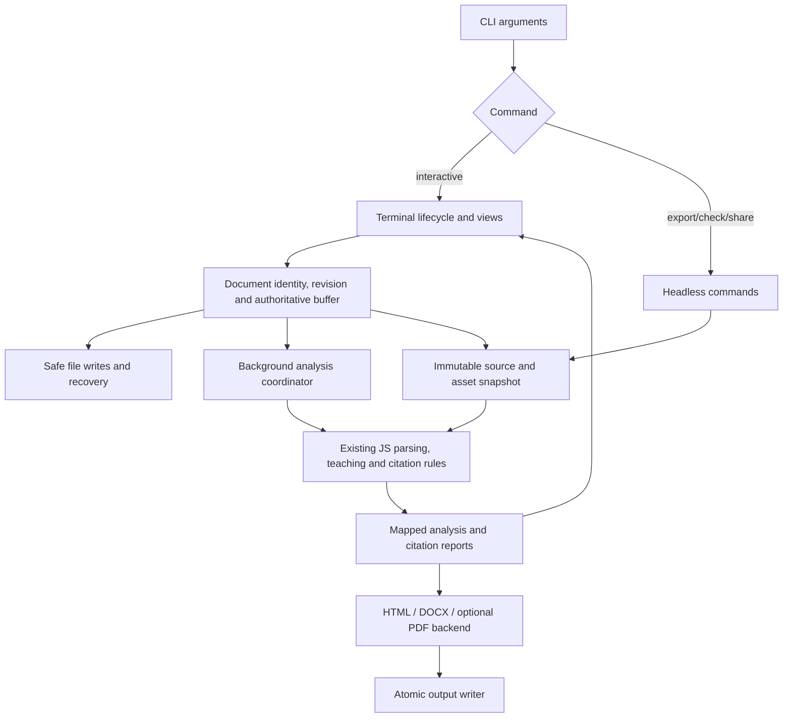

# Loomings TUI — construction plan

Prepared: 2026-11-07. Status: proposed implementation; source audit completed.

Repository baseline: `05b79eb` on `main`, root package version `2.6.5`, including
the working-tree changes present during this audit. Several existing files are
already modified. Implementation must preserve those changes and establish a
fresh baseline before touching shared code. This document authorizes no release,
publication, or change to the installed web or Mac applications.

All commands, modules, flags, thresholds and milestones below describe work to
build unless explicitly identified as existing. External documentation was
checked on the preparation date. Framework APIs and runtime requirements must be
rechecked against the exact release selected in step 01.

## Navigation

- [Outcome and scope](#1-outcome)
- [Current source and reuse audit](#2-evidence-from-the-current-repository)
- [Architecture and framework gate](#3-architecture-decision-and-framework-gate)
- [Package boundaries and contracts](#4-package-and-module-boundaries)
- [Terminal interface and keys](#5-terminal-interface-and-input)
- [Editor and Unicode](#6-editor-model-and-unicode-correctness)
- [Files, saves and recovery](#7-files-saves-recovery-and-external-changes)
- [Preview and presentation](#8-markdown-preview-source-maps-and-presentation)
- [References and CSL](#9-references-citation-syntax-and-csl)
- [Background work and freshness](#10-background-work-freshness-and-failure-containment)
- [Exports](#11-export-design)
- [Shell commands](#12-shell-interface)
- [Lessons, sharing and clipboard](#13-lessons-sharing-and-clipboard)
- [Terminal lifecycle and platforms](#14-terminal-lifecycle-accessibility-and-platforms)
- [Packaging and CI](#15-packaging-assets-licensing-and-ci)
- [Acceptance and tests](#16-acceptance-and-verification-strategy)
- [Twelve implementation steps](#17-implementation-sequence)
- [Decisions, risks and maintenance](#18-decision-log-progress-and-plan-maintenance)

## 1. Outcome

Build a terminal version of Loomings that opens a Markdown file immediately,
lets the writer type without changing editing modes, keeps the essential
commands visible, and produces the same supported citations and reference list
as Loomings on the web and Mac.

The first public release must support serious writing: dependable editing,
safe saves and recovery, an outline, find and replace, Write/Split/Preview,
reference search and insertion, bundled and local CSL styles, Markdown/HTML/Word
export, PDF through an explicitly configured local renderer, lessons and share
interoperability. References and export are release requirements.

The terminal experience should have nano's immediacy and discoverability. It
should retain Loomings' restrained colours, prose-oriented defaults, ordinary
files, teaching material and local operation. It is a companion to the existing
surfaces, with its own terminal-specific presentation.

### Representative journeys

1. Run `loomings chapter.md`, write, save, quit, and reopen the exact text.
2. Open a paper with `bibliography: refs.bib`, search by author or title, insert a
   key, change its CSL style, and export a Word document with formatted references.
3. Run an export from a shell without initializing a terminal renderer.
4. Open a bundled lesson in Split, complete the exercise, and inspect its checks.
5. Recover an unsaved draft after a killed process without overwriting a newer file.
6. Open a Loomings share link, read its carried references, and save a local copy.

### Scope boundaries

- One active document per process in release 1; multiple terminal windows already
  provide independent editing sessions. Additional buffers are a later feature.
- Local files, explicit share links, and local exports. No accounts, sync server,
  AI features, plugin execution, network bibliography lookup or automatic downloads.
- No vault, tags, wikilinks, project manager or permanent file tree. Open/Save
  dialogs may navigate directories without introducing a new document model.
- Standard Loomings Markdown and its existing citation syntax. Do not advertise
  complete Pandoc Markdown, complete YAML, or arbitrary CSL capability.
- A source diagram or image can be represented textually in the terminal while
  the exported document contains the graphic. Terminal graphics protocols are
  optional future enhancements.
- Terminal font family, terminal font size, OS printing dialogs, PWA installation,
  browser IndexedDB and AppKit window management belong to their host platforms.

## 2. Evidence from the current repository

Use the implementation and shared fixtures as the behaviour contract. The
[README](../README.md), [product document](../PRODUCT.md) and
[Mac acceptance report](../macos/ACCEPTANCE.md) provide context, but contain
historical descriptions. For example, PRODUCT's conversion scope predates the
current Word exporter, and the Mac acceptance report includes results from older
releases. Do not copy their test counts, performance numbers or parity claims
into a TUI release report.

| Existing source | Verified role | TUI treatment |
|---|---|---|
| [`src/editor.js`](../src/editor.js), `browser.js`, `style.css`, `index.html` | Browser editor, storage and UI integration | Build a terminal frontend and filesystem adapters; do not transplant these files. |
| [`src/session.js`](../src/session.js) | Injectable dirty state, scratch ordering, save serialization and document generations; draft delay 800 ms, autosave delay 2000 ms | Reuse its race guarantees where suitable. Explicit terminal Save is the proposed default; do not accidentally inherit timed writes to the source file. |
| [`src/save-route.js`](../src/save-route.js) | Browser save-home decisions | Reference its separation of Save and Save As; the terminal does not need browser-document routing. |
| [`src/markdown.js`](../src/markdown.js) | markdown-it configuration, URL rules, frontmatter stripping, source-line HTML attributes | Reuse export rendering and sanitization. The terminal preview must use this dialect, not a framework's unrelated Markdown interpretation. |
| [`src/teaching/parse.js`](../src/teaching/parse.js) | Markdown tokens, line maps, UTF-16 source ranges; frontmatter closes within the first 50 lines | Reuse analysis and mappings; retain existing fixture behaviour. |
| [`src/teaching/report.js`](../src/teaching/report.js) | Checker, exercise checks and section word limits | Reuse analysis in a background worker. |
| [`src/teaching/glossary.js`](../src/teaching/glossary.js) | Marker explanations plus CodeMirror syntax-tree lookup | Reuse explanation text; supply a terminal marker lookup or a separately proven headless parser adapter. |
| [`src/citations/bib.js`](../src/citations/bib.js), `item.js`, `scan.js`, `frontmatter.js`, `style.js`, `engine.js`, `session.js`, `output.js` | BibTeX/BibLaTeX parsing, sanitization, citation syntax, metadata, citeproc formatting, diagnostics and formatted output | Reuse the JavaScript implementation directly. Do not create a third citation engine. |
| [`src/citations/library.js`](../src/citations/library.js) | Source selection, native path planning and dependent-style handling | Use `planNativeSources` for disk-oriented semantics; implement the actual file reads in the TUI. |
| [`src/citations/assets.js`](../src/citations/assets.js) | Vite `import.meta.glob` style/locale loading | Replace with a packaged-asset adapter. |
| [`src/citations/client.js`](../src/citations/client.js), `worker.js`, `document.js` | Browser workers and freshness coordination; some reusable HTML helpers | Replace the worker transport and orchestration. Preserve exact-snapshot export guarantees; reuse pure helpers after auditing imports. |
| [`src/citations/panel.js`](../src/citations/panel.js) | Pure reference filtering/insertion/metadata rules alongside DOM panel functions | Reuse or narrowly extract the pure functions; do not import a browser panel as a terminal widget. |
| [`src/export.js`](../src/export.js) | Standalone HTML, diagram colour rules | Reuse string generation. Audit its transitive import of `mermaid.js` and its current hardcoded HTML language before claiming fully generic reuse. |
| [`src/docx.js`](../src/docx.js) | HTML-to-Word export, Word style IDs, injected HTML parser and image loader, Blob output | Reuse with an inert HTML parser and local image adapter. Convert the returned Blob to bytes for disk output. |
| [`src/mermaid.js`](../src/mermaid.js) | Pele loading plus DOM-based diagram replacement | Adapt diagram rendering; pure colour helpers are separable. A terminal process cannot call `document.createElement`. |
| [`src/share.js`](../src/share.js), `theme-link.js` | Share payloads, limits and theme URL parameters | Reuse after runtime verification; provide raw-DEFLATE adapter only if required. |
| [`src/palettes.js`](../src/palettes.js) | Ten Ensigns families plus Tryworks, light/dark roles | Reuse all entries from `FAMILY_ORDER`; do not hardcode a count or invent terminal hex palettes. |
| [`src/stats.js`](../src/stats.js), `accents.js`, `links.js` | Word count/reading time, accent folding, paste-over-selection link rule | Reuse pure functions and their fixtures. |
| [`src/typography.js`](../src/typography.js), `search.js`, `cm-theme.js` | CodeMirror input handling, search integration and themes | Reuse intended behaviour selectively; these are not drop-in terminal adapters. |
| [`src/lessons.js`](../src/lessons.js), [`lessons/`](../lessons/) | Six Markdown lessons loaded through Vite; exercise definitions in `checks.json` | Package the source lessons and checks through a manifest. Do not load `import.meta.glob` at runtime. |
| [`scripts/export-native-resources.mjs`](../scripts/export-native-resources.mjs) | Existing asset export for the Mac app | Follow its source-of-truth and attribution approach; give the TUI its own output target. |

Important existing limits:

- Bundled styles are Chicago author-date, APA, Vancouver, AMA and IEEE. The
  default is Chicago author-date. Bundled locales are en-US, en-GB, pt-PT and es-ES.
  Read these lists from `style.js` when building the package.
- The existing formatter uses `noteIndex: 0` for citation clusters. A custom CSL
  file passing the current structural check does not establish correct footnote
  or endnote processing. Release 1 must document and diagnose that limitation.
- Dependent styles resolve one local/bundled independent parent, including the
  existing aliases. They do not recursively fetch the CSL repository.
- `references:` carries sanitized CSL-JSON entries in the frontmatter. This does
  not imply standalone `.json` bibliography-file support.
- Citation/teaching ranges use JavaScript UTF-16 indices. Terminal cells, UTF-8
  bytes, Unicode code points and grapheme clusters are different coordinate units.
- The frontmatter reader supports a deliberate subset, not a general YAML round
  trip. Preserve unrelated metadata and comments through the existing edit rules.
- `stripFrontmatter` in the HTML renderer and the teaching/frontmatter reader do
  not have identical recognition rules. Preserve existing contracts and add a
  regression case rather than silently standardizing one surface during this work.
- HTML export currently references image URLs and uses system font stacks. The
  term "standalone HTML" does not itself mean that every external asset is embedded.

## 3. Architecture decision and framework gate

### Proposed default

Use JavaScript ESM with JSDoc/checkJs, an isolated `tui/` package, the shared
JavaScript document/citation/teaching core, and **OpenTUI Core under Bun** for the
terminal frontend, subject to the step-01 gate. Use imperative Core renderables;
adding React or Solid is unnecessary for the initial interface.

This is a recommendation based on reuse and editing primitives, not a claim
that a multiline widget is already a complete writing editor. OpenTUI documents
an editing buffer with undo and an editor view with wrapping and selection.
Its native binding, Unicode mapping, programmable transactions and packaging
must be proven on our corpus. [OpenTUI editing reference](https://opentui.com/docs/extend/editing/)

Current runtime documentation lists Bun 1.3.14+ and Node 26.4+ with ESM and
`--experimental-ffi`; this is materially different from Loomings' Node 22.12+
web development floor. Native package availability also differs from tested
platform coverage. Keep the TUI runtime requirement separate and lock its tested
version. Do not upgrade the web toolchain merely to accommodate the terminal UI.
[Runtime and platform support](https://opentui.com/docs/getting-started/runtime-support/)

| Candidate | Advantage for this project | Cost or uncertainty | Decision |
|---|---|---|---|
| OpenTUI Core + Bun | Existing JS core can run in-process; native editor and terminal rendering primitives | Native artifacts, runtime compatibility, v0.x API changes, offset conversion and full editor behaviour need tests | Preferred spike. |
| Ink + Node | JS reuse and a React terminal renderer with input handling | A full editor buffer, viewport, selection and undo design still need to be supplied/proven; adds React to this frontend | Fallback if OpenTUI fails and Node is the preferred deployment constraint. |
| Bubble Tea/Bubbles + Go | A Go terminal architecture and multiline input components | Citation parity requires a JS runtime/subprocess or a carefully reviewed port; a widget is not proof of long-document editor quality | Revisit if a Go distribution becomes an explicit priority. |
| New ANSI/curses editor from scratch | Complete control | Owns keyboard parsing, cells, terminal cleanup, selections and editor correctness | Reject for the initial implementation. |

Ink is documented as a React command-line renderer with `useInput`; Bubbles
documents a multiline textarea. Those capabilities are not evidence of full
Loomings editor parity. [Ink](https://github.com/vadimdemedes/ink),
[Bubbles](https://github.com/charmbracelet/bubbles)

CodeMirror's state and document packages are separable from its DOM view. They
are an option for a future/custom model, not an automatic solution to terminal
rendering. Do not maintain an OpenTUI buffer and a second CodeMirror document
as competing authorities. [CodeMirror system guide](https://codemirror.net/docs/guide/)

### Step-01 pass/fail decision

Build a disposable editor proof using a pinned release and record:

- Ordinary input, selection, paste, undo/redo and programmatic edits as one undo
  unit; no loss of history when styling or changing themes.
- Exact mappings around accents, decomposed characters, tabs, CJK, emoji/ZWJ
  sequences and multiple lines. Never use `cursorCharacterOffset` as an unchecked
  JavaScript string index: its documented limitations include wide characters and
  line breaks. [Textarea reference](https://opentui.com/docs/components/textarea/)
- Soft wrapping, preferred horizontal position for up/down, Home/End, Page Up/Down,
  selection across wrapped lines, resize, and a 256 KiB single logical line.
- Main-thread responsiveness with 10 KiB, 100 KiB, 1 MiB and 10 MiB source files.
- Local imports of citeproc, citation-js, markdown-it and the Word exporter under
  the selected runtime; an analysis worker and its cancellation path.
- Source and packaged execution outside the checkout; bundled worker and native
  assets on each intended initial target.
- Clean terminal restoration after startup failure, normal exit and termination.

If any correctness requirement fails, record an ADR with the failing case and
choose another candidate or a bounded upstream patch. Do not proceed by keeping
an unsafe text-editing implementation behind a feature flag. Avoid promising a
single executable before proving its native assets and workers.

## 4. Package and module boundaries

Keep the terminal app isolated. Initially import audited shared modules from
`../src` during development and bundle them into the distributed artifact. An
installed TUI must never require a neighbouring repository checkout. A separate
`shared/` package can follow if multiple surfaces actually benefit; no wholesale
reorganization is a prerequisite.

Declare all used shared-library dependencies in the TUI manifest and initially
align their versions with the root lockfile. Shared source outside `tui/` resolves
bare imports relative to its own directory during development; make that explicit
in setup/build rather than accidentally depending on whatever is installed in a
parent `node_modules`. The bundler must resolve against the intended locked graph.
An isolated packed-artifact test with the root dependencies unavailable proves
that the distributed package is self-contained.

Proposed layout:

```text
tui/
  README.md                 # navigation and actual setup once implemented
  PLAN.md
  package.json              # independent version, commands and executable mapping
  bun.lock                  # selected/pinned Bun dependency graph
  jsconfig.json             # runtime-specific checking; excludes browser globals
  src/
    cli.js                  # parse arguments; choose headless or interactive path
    commands/               # export, share, check, styles, lessons, doctor
    app.js                  # document lifecycle and UI command dispatch
    editor/                 # one buffer owner, transactions, coordinate maps
    terminal/               # lifecycle, input, capabilities, clipboard, rendering
    views/                  # editor, preview, outline, references, prompts/help
    analysis/               # worker transport, generations, scheduling
    documents/              # codec, filesystem writes, conflict and recovery store
    citations/              # disk source resolver and asset adapter
    export/                 # snapshot coordinator, images, HTML, DOCX, PDF adapters
    assets.js               # generated manifest lookup with no runtime Vite glob
  scripts/                  # asset generation, build, package verification
  test/                     # core, render/input, PTY, exported-document fixtures
  assets/                   # generated copies, manifests and required notices
  decisions/                # ADRs after the early gates
  dist/                     # generated release output, excluded from git
```

The build must have a closed import graph. Headless commands must not initialize
OpenTUI, FFI, raw mode, a clipboard, or a browser. Export libraries and the PDF
backend load only when needed. Shared code changes retain the root test suite;
new terminal-specific code uses its own check configuration.

### Runtime flow



### Contracts to define before parallel work

- `DocumentSnapshot`: document ID/generation, revision, exact source string,
  file/base-directory identity, provenance (`local`, `stdin`, `lesson`, `share`),
  explicit filesystem authority, encoding/EOL policy and original disk fingerprint.
- `AnalysisRequest`: document generation, revision, source and asset revision;
  `AnalysisReply` echoes all identifiers with reports/diagnostics.
- `CitationSnapshot`: exact source plus resolved bibliography/style/locale bytes
  and their fingerprints. A style or `.bib` change creates a new asset revision
  even if the Markdown is unchanged.
- `TextEdit`: UTF-16 half-open range, replacement text, desired selection and
  undo-group intent. Convert at the editor boundary and validate both endpoints.
- `Diagnostic`: origin, severity, message, optional UTF-16 range and file/line.
  Labels distinguish citation problems, teaching feedback and filesystem failures.
- `ExportResult`: destination, source/asset revision, warnings and success/failure;
  a warning must not be confused with a complete citation report.

The document controller owns identity; the editor owns the live text buffer;
analysis workers own parsing/citeproc state; the storage adapter owns persistence;
the terminal lifecycle owns TTY restoration. Avoid global mutable document state.

## 5. Terminal interface and input

### Layout

```text
 Loomings                     paper.md                         Modified
 ----------------------------------------------------------------------
 # Introduction                   | Preview / References / Checks
                                  |
 Previous work [@smith2024].       | Previous work (1).
                                  |
                                  | References
                                  | 1. Smith ...
 ----------------------------------------------------------------------
 428 words   Ln 8, Col 12   UTF-8/LF   Vancouver   1 citation issue
 ^O Save    ^X Exit    ^W Find    ^T Commands    ^G Help
```

The citation above is illustrative: punctuation and numbering are produced by
the selected CSL. Source markers stay visible while editing. Show a filename,
dirty/read-only state, transient messages, cursor location, word count and issues.
Allow a quiet focus view that hides secondary chrome while retaining a clear
route to help and save.

Initial layout rules, to refine in usability tests:

- At 120 columns and above, Split can give both panes useful writing width.
- Below that, switch to a full-width active pane and preserve the requested split
  preference for a later resize. Do not squeeze two panes into unreadable columns.
- At 80×24 all core commands remain usable. At 40×10 provide a compact single pane
  with scrolling prompts; below the supported minimum show a resize message while
  continuing to preserve the draft.
- Editor width is configurable in cells, with an approximately 72–80-cell default.
  Empty space may center the writing area on wide terminals.
- Outline, references and checks use overlays or the existing right pane. Opening
  one preserves the editing selection and returns focus predictably.
- Prompts have labels, error text, Escape/cancel and keyboard completion. No action
  depends on a mouse, colour alone, hover or an enhanced keyboard protocol.

### Keymap proposal

| Action | Baseline binding | Notes |
|---|---|---|
| Save / Save As | Ctrl+O / command menu | Prompt for a name when untitled; show save failures. |
| Quit | Ctrl+X | Dirty documents offer Save / Discard / Cancel. |
| Find / replace | Ctrl+W / Ctrl+Backslash | Prompt-local editing bindings may differ from document bindings. |
| Help / command menu | Ctrl+G / Ctrl+T | Every capability must be reachable here. |
| Select | Alt+A to set/clear a mark | Shift movement is additional where the terminal reports it reliably. |
| Undo / redo | Alt+U / Alt+E | Support Esc then letter as a Meta fallback. |
| Cut line or selection / paste internal cutbuffer | Ctrl+K / Ctrl+U | System clipboard remains a separate capability. |
| Cancel / status | Escape / Ctrl+C | Ctrl+C does not discard a document. |
| Suspend | Ctrl+Z on POSIX | Restore terminal before suspension and redraw on resume. |

Formatting, outline, citation insertion, theme, focus, width, goal, view and export
commands have stable command IDs; assign optional accelerators after testing
actual terminals. Do not copy Cmd-based browser shortcuts blindly: Ctrl+I is Tab,
Ctrl+M is Return, and flow-control or terminal shortcuts can consume other chords.
Offer explicit keymap overrides in a data-only config with collision diagnostics.

Ordinary insertion is always available; overlays capture input only while open.
Bracketed paste must be recognized as a single paste transaction, with no smart
typography, shortcut execution or automatic indentation replay per pasted key.
Buffer incomplete UTF-8/key sequences across reads and distinguish a lone Escape
from a Meta sequence with a tested, configurable timeout. Delegate protocol parsing
to the framework wherever it is correct.

Enhanced keyboard negotiation can improve disambiguation but must have a legacy
fallback. Restore every negotiated mode on exit.
[Kitty keyboard protocol](https://sw.kovidgoyal.net/kitty/keyboard-protocol/)

## 6. Editor model and Unicode correctness

One editor buffer is authoritative. Styling, the outline, citations and preview
are derived state; none may reset the buffer or its history on each refresh.

Required editing behaviour:

- Insert/delete, newline, tabs, selection replacement, word movement, logical
  line and visual-row movement, Home/End, Page Up/Down, select all and go to line.
- Undo/redo with sensible typing groups; paste, replace-all, formatting and
  metadata edits are deliberate undo units. Search and theme changes are not edits.
- Soft wrap changes presentation only. Saving never inserts visual-wrap newlines.
- Formatting commands for bold, italic, code, links, headings, lists and quotes;
  continuation and termination rules match current Loomings fixtures where they
  exist. A link pasted over a selection uses `linkFromPaste`.
- Accent-insensitive find, exact case-sensitive find, next/previous, selected
  replacement and replace-all. Regex search may follow after its replacement and
  time-limit semantics are specified; do not ship a potentially blocking regex loop.
- Search normalization must map back to original ranges: accent folding changes
  lengths for decomposed text and cannot be used directly as a replacement index.
- Outline includes ATX and setext headings and excludes fenced code/frontmatter.
- Full Unicode preservation. A terminal can limit glyph/BiDi presentation; that
  must not corrupt stored RTL or complex-script text.

Implement and test a coordinate adapter with explicit unit names. Shared ranges
are UTF-16; buffer operations use the framework's actual documented unit; view
rows/columns are cells. Cache mappings per changed logical line and invalidate
them when text, tab width or terminal width policy changes. Define the displayed
column convention and expose a separate visual column if helpful.

Use one canonical LF-normalized text representation for the live buffer and its
analysis/export snapshots; encoding, disk EOLs and final-newline state belong to
the codec record. "Exact source" means the exact text of that captured buffer
revision, not a differently normalized string. Apply every range-producing shared
function to that same string. Convert to the chosen disk representation only at
the persistence boundary; an untouched opened file may retain its original bytes
for a byte-identical no-op save. Test CRLF/multiline offset cases explicitly.

Grapheme-aware left/right/deletion must keep surrogate pairs, combining marks,
variation selectors and ZWJ emoji intact. Selection boundaries and width-clipping
must not split a wide glyph. Test ambiguous-width glyphs under configured terminal
width policy. A UTF-16 index cannot be obtained by counting terminal cells.

Smart typography starts **off by default**. A terminal commonly receives committed
IME/dead-key text rather than browser composition events; the browser input plugin
cannot be reused blindly. Enable transformations only after validating Portuguese
dead keys, IME input, literal code and paste. Composition must never be damaged.

Do not copy the whole document, fully parse Markdown or run citeproc on every key.
Take snapshots on debounced analysis or explicit export, use dirty-line updates
for display, and bound the undo history by a documented memory policy.

## 7. Files, saves, recovery and external changes

### File contract

Resolve command-line file arguments from the invocation directory. Once opened,
relative bibliographies, CSL files and images resolve from the document's own
directory. An untitled document needs an explicit base directory before resolving
relative files; its default is the captured invocation directory, shown in the UI.
This default applies to a locally created document, not an imported share. A share
starts with no filesystem authority or inherited directory; see section 9.
Saving As to another directory re-resolves the unchanged metadata and reports
broken paths; offer an explicit rebase operation rather than rewriting paths silently.

Release 1 should preserve UTF-8 with/without BOM and UTF-16 LE/BE with BOM,
homogeneous LF/CRLF/CR line endings and final-newline state. Reject malformed input,
binary files and unsupported encodings with an actionable message; do not decode
with replacement characters and save over the original. For mixed endings, keep
the untouched byte representation and require a clear conversion choice before
an edit/save unless per-line EOL preservation has been implemented and tested.

Explicit Save is the default. Crash-recovery drafts are automatic; optional
autosave-to-source is a separate, visible preference. Reusing `src/session.js`
requires separating its timed source saves from its useful ordering/generation
guarantees, with browser regression coverage.

### Safe write protocol

1. Capture immutable source, encoding/EOL choices, document generation and the
   expected current on-disk identity/content fingerprint.
2. Check the destination, permissions, concurrent changes and symlink policy.
   Read-only and filesystem errors keep the buffer dirty and the draft intact.
3. Write a uniquely named temporary file in the destination directory; fully write
   and flush it. Preserve applicable mode/metadata according to a tested OS policy.
4. Recheck for detected external changes immediately before replacing the target.
   Atomic rename does not provide a portable compare-and-swap against another
   writer; document this residual race and use advisory coordination between
   Loomings processes. Never claim cross-process conflict immunity.
5. Replace atomically where the filesystem supports it, flush directory metadata
   where supported, and clean temporary files on failures without deleting drafts.
6. Mark only the saved revision clean. An edit or document switch during the write
   must not be marked saved by a late completion.

Save As and export never overwrite an existing destination without an explicit
interactive choice or headless `--force`. Export must refuse the current input
path or the same underlying file, even with `--force`; editing source and exporting
are separate operations. Reject directory/device/FIFO/socket inputs in release 1.

Resolve symlinks deliberately and preserve the symlink itself when writing its
referent; revalidate its target before commit. Detect multiple hard links and
metadata-preservation limitations: atomic replacement can change link identity,
ownership, ACLs or extended attributes. Offer Save As or an explicit documented
policy instead of silently promising preservation. Network filesystems may have
weaker guarantees; test or report their limits.

Watchers are hints, not the authority: re-stat/read when resuming, before saving
and before export. A clean buffer may reload with status and preserved position;
a dirty buffer offers Compare / Reload / Save Copy / explicit Overwrite. A watcher
must never replace unsaved work. Detect another Loomings process on the same file
and offer read-only/open-anyway; stale lock ownership must be checked, not guessed.

### Recovery and application state

- Use an OS-appropriate per-user `loomings-tui` configuration/state/cache location;
  respect XDG locations on Unix and native equivalents where supported. A data-only
  config may override directories. Do not store this state beside the executable.
- Keep each process/document's recovery record under a stable unique ID, with
  original path, source/asset identity, revision, timestamp and codec information.
  Persist provenance and filesystem authority too: recovering an unadopted share
  must not upgrade it to a trusted local document. Drafts must never share a single
  global scratch file.
- Serialize atomic recovery writes; an older in-flight write cannot overwrite a
  newer draft or resurrect a discarded document. Debounce near the current 800 ms
  baseline and measure it. Recovery is best effort since the last completed write.
- Store draft/config files with user-only permissions where available. Do not put
  document text or bibliography contents in routine logs or recent-file labels.
- After restart, offer recovery records with timestamps and a comparison against
  the current file. Recovery opens a dirty buffer; it never overwrites the source.
- Remove a matching recovery record only after a successful save of that revision
  or explicit discard. Failed saves, worker crashes and export failures retain it.
- Handle SIGINT/SIGTERM/SIGHUP with bounded best-effort draft flush and terminal
  cleanup. SIGKILL and power loss cannot run cleanup; test the persisted draft.
- Recents, theme, width, goals and feature choices are separate from document text.
  Schema-version state and preserve unknown/newer config instead of overwriting it.

## 8. Markdown preview, source maps and presentation

Offer Write, Split and Preview. The preview is a terminal rendering of Loomings'
Markdown semantics: headings, emphasis, strong text, lists, quotes, fenced/inline
code, links, rules and tables, plus formatted citations and a reference list.

Use the shared Markdown configuration or its canonical token stream. A framework's
built-in Markdown component may be used only if it can consume that contract or
has proven equivalent output. Do not introduce different linkification,
frontmatter, raw HTML or smart-punctuation rules by accident.

Map rendered rows back to source blocks. Clicking/jumping a heading or scrolling
the active pane can anchor the other pane at the same source block. Start with
block anchoring and label the behaviour accurately; pixel-like synchronization
is not meaningful between wrapped terminal rows and source lines. Avoid a feedback
loop between two scrolling panes. Preserve the anchor when only widths change.

Reference text retains italic/bold/superscript meaning where the terminal supports
it, with a readable fallback where it does not. Tables must support horizontal
scrolling or a clear narrow-layout representation without truncating data.

Images show alt text and their path; diagrams show their fenced source or a
caption/status. No network image is fetched during ordinary editing. Raw HTML is
displayed according to the existing escaped/literal policy and never executed.

Derive theme roles from `palettes.js`. Offer explicit dark/light and a
terminal-default mode; OS/browser `prefers-color-scheme` is unavailable. Detect
capabilities conservatively and allow override. Test truecolour, 256-colour,
16-colour and monochrome output, plus `NO_COLOR`. Quantization must preserve usable
selection/focus; browser contrast tests alone do not prove terminal legibility.

The UI must not execute escape/control strings from document text, paths, titles,
references, errors or subprocess output. Escape them at the display boundary;
preserve source bytes in the document model. Distinguish terminal paste-sanitizing
policy from file-content preservation, and test the framework's default stripping
so it cannot silently change an imported document.

## 9. References, citation syntax and CSL

### Document representation

Keep the existing source syntax and metadata:

```markdown
---
title: Example paper
bibliography:
  - references.bib
  - ../shared/methods.bib
csl: styles/journal.csl
lang: pt-PT
reference-section-title: Referências
---

Earlier work supports this approach [@smith2024, p. 12].
```

Accept a bundled style ID such as `vancouver` in place of a custom path. Reuse the
scanner's supported narrative citations, clusters, locators, prefixes/suffixes and
suppressed authors rather than implementing an independent regular expression.
Citation-like text in code, URLs, metadata and excluded ranges stays literal.

### Disk resolver

- Drive reads with `planNativeSources`; preserve exact path identity so two
  `refs.bib` files in different directories are not matched by basename.
- Read BibTeX/BibLaTeX text and feed `parseBibliography`; retain malformed-entry
  notes and duplicate-key resolution from the existing session, with file context.
- Prefer an explicitly named local CSL file over a bundled style with the same
  name according to the native plan. Resolve dependent parents locally/bundled;
  report a missing or unsupported parent. Never fetch a style URL automatically.
- Supply the requested supported locale and the en-US fallback. Show any locale
  fallback in configuration/status; do not claim every language is bundled.
- Re-read changed `.bib` and `.csl` files, invalidating the asset revision. A renamed,
  missing or unreadable file produces a diagnostic without freezing editing.
- Bound file sizes, entry counts, XML depth/input, analysis time and worker memory
  from measured fixtures. The exact release limits belong in `doctor`/help and
  tests; they are not inherited from the separate share-payload limits.
- Saved local documents may explicitly refer outside their folder. Imported share
  documents have **no filesystem authority** until an explicit Save/adopt action
  establishes a local base directory. Before adoption, use only embedded references
  and bundled styles/locales; do not read even relative bibliography, style or image
  paths. Enforce this in the I/O adapter, before calling the native source plan.
  Its `allowPaths:false` guard is lexical, still permits relative names and cannot
  prevent symlink escapes; it is insufficient as a complete trust boundary. Apply
  the same policy to images, export assets and recovered unadopted drafts.

### References interface

Provide a searchable overlay/right-pane view using the existing accent/case-folded
filter rule. Search author, year, title and key; indicate cited/uncited/missing
entries. Virtualize/paginate long lists and preserve the selected key as results
refresh. Enter inserts the key; Escape returns to the original editor selection.

Use `insertCitation`, metadata editing and choice rules from `panel.js` where
pure. Inserting into an existing cluster or at frontmatter positions must follow
the existing contract. All insertion and bibliography/style/language changes are
single undoable document edits. A locator editor can generate supported syntax;
it must not introduce a second citation representation.

Show formatted output through the same report used by preview/export. Process
citation clusters in document order, then let CSL control citation ordering,
numbering, disambiguation and bibliography sorting. Switching styles recomputes
these results; the frontend never independently resorts the formatted bibliography.
Provide a representative example for style selection without changing the draft.
Keep library filtering usable while a background formatting job is running.

### Scope of CSL support

Release 1 promises parity for the five bundled author-date/numeric styles and
custom independent styles that work within the existing engine's supported
behaviour. Identify note-class styles before presenting them as supported; either
reject them clearly in this surface or extend the shared engine with note-aware
processing and cross-surface fixtures in a separately reviewed change. Do not
invent footnote numbers around the current `noteIndex: 0` implementation.

The structural `checkStyle` helper is not complete CSL schema validation. Catch
processor errors, display diagnostics and keep source recoverable. Missing styles
follow the existing noted default-style fallback in preview; malformed styles keep
citations literal. Exports add the explicit preflight described below.

## 10. Background work, freshness and failure containment

Typing and painting must not wait for full-document parsing, citeproc, image
decoding or PDF generation. Use a lazy worker only for documents that need its
work. A document without citation metadata must not initialize citeproc or parse
an unrelated bibliography.

- Debounce analysis near the existing 300 ms citation coordination baseline;
  coalesce queued snapshots and retain at most the active job and newest pending
  request. Do not let an unbounded queue accumulate on each key.
- Every reply carries document generation, source revision and asset revision.
  Discard stale replies. Never remap an old report into an export of new text.
- Preview can display the last successful result with an updating indicator;
  it must not present stale citation positions as current editing targets.
- Use the shared session's cached rendering when citation inputs are unchanged.
  A style/locale/bibliography change resets the appropriate engine state.
- A worker timeout/crash yields a visible diagnostic, leaves editing and recovery
  running, and allows an explicit restart. Terminate and recreate stuck workers;
  an AbortSignal cannot preempt a synchronous citeproc loop on its own.
- Keep teaching feedback, outline and citations independently usable after one
  job fails. Never substitute a lesson success result for an unavailable checker.
- Export captures its own immutable source+assets, asks for that exact report and
  can be cancelled independently. It may finish an older captured revision while
  the writer continues; label the exported revision and never change dirty state.

Start by preserving the existing 10-second citation export-flush expectation as
a configurable timeout, then measure real cases. Cancellation and deadlines must
also cover file reads, child processes and cleanup, with bounded shutdown.

## 11. Export design

### One pipeline for interactive and shell use

```text
capture source + base directory + resolved asset bytes + preferences
  -> parse metadata and produce exact citation report
  -> preflight diagnostics and chosen warning policy
  -> citedHtml(source, report, renderMarkdown)
  -> diagram/image adaptation
  -> HTML, DOCX or PDF serializer
  -> atomic output writer
```

The TUI menu and headless CLI call the same export service. Terminal cell styles
never become the document's formatting. The same citation engine formats once;
do not pass already formatted citations through another citeproc backend.

### Output contract

| Format | Release-1 behaviour | Dependencies and verification |
|---|---|---|
| Markdown | Save/export editable source, retaining keys and metadata. A separate explicit rendered-Markdown option may write formatted citations and a bibliography without touching source. | Codec/EOL tests and content comparison. Rendered Markdown must not retain active citation metadata that would cause double processing. |
| HTML | Standalone document, current Loomings theme, formatted citations/reference list, valid language metadata, tables and supported diagrams/images. | Reuse `exportHtmlPage` and shared rendering. Existing `lang="en"` needs a backward-compatible optional language parameter or a narrowly scoped wrapper with tests. |
| DOCX | Current Word style contract, citations, reference list, lists, tables, links and supported local images. | Reuse `htmlToDocx` with `parse` and `loadImage`; write Blob bytes. Check package XML, relationships, bibliography styles and visible examples. |
| PDF | Print-oriented HTML rendered by a configured local browser backend, with chosen A4/Letter size, margins, page breaks, citations and reference list. | Optional installed Chromium-compatible executable and a pinned automation adapter. Missing backend is an actionable failure, not a placeholder PDF. |

Keep HTML's theme and PDF's paper styling distinct. PDF should default to a light
print layout even if the terminal is dark. Header/footer/page-number features
must be explicit and tested; do not leak browser URL/date headers into output.

### Word adapter

The exporter already accepts a parser and image loader. Evaluate a minimal inert
HTML DOM implementation against the DOM operations actually used in `docx.js`;
the existing tests inject happy-dom, but a development test dependency is not
automatically the best production dependency. Parsing must not run scripts,
custom elements or fetch resources. Close/dispose parser resources after export.

Preserve Title, Heading1–6, Quote, Bibliography, SourceCode and Hyperlink style IDs
and the fixture-defined numbering/hanging-indent behaviour. These are normal Word
styles, not Zotero/EndNote live citation fields. A `.dotx`/reference-document import
is a future feature; current style IDs alone do not mean arbitrary template import.

Load and inspect local image bytes, identify formats/dimensions, and enforce limits
before decoding. Reuse current missing-image fallback with diagnostics. SVG/diagram
rasterization is a separate adapter, with network access disabled and resource
limits. A failed graphic must preserve its source/alt explanation rather than
silently vanish.

### Diagrams and images

An audit smoke check of installed Pele 1.13.0 successfully rendered a flowchart
and a sequence diagram through `pele/lazy`'s `renderAsync`, with `document`
undefined. Thus string-to-SVG rendering is available without the browser DOM;
the current `src/mermaid.js` replacement wrapper still needs adaptation. Use an
explicit string/SVG adapter with the existing links/images restrictions. The
selected runtime, complete supported diagram corpus, CSS-variable/font handling,
SVG sanitization, rasterization and packaged lazy chunks remain implementation
gates. Keep a local-browser path only where a proven export stage requires it.

HTML supports two explicit asset policies: linked local assets (with a portability
note) and portable embedding of approved local images. Rebase relative paths to
the output directory or embed them; do not silently break them when exporting
elsewhere. Network images remain unresolved or produce an explicit diagnostic;
release 1 makes no automatic network requests. Enforce caps on data URIs too.

### PDF backend decision

Prefer printing the exact generated HTML through a local Chromium-compatible
browser so citations, diagrams and print CSS share the export pipeline.
Puppeteer's documented `Page.pdf()` uses print CSS; the exact adapter, browser
discovery and runtime compatibility must pass the export spike before adoption.
[Page.pdf](https://pptr.dev/api/puppeteer.page.pdf)

Use a core/connection package with no automatic browser download during install,
editing or export. Support an explicit `--browser` executable or data-only config.
`doctor` reports discovery and version; installation instructions explain the
optional dependency. Keep the normal browser sandbox enabled. A remote display is
not required for headless export.

Run the page in an isolated context with request interception: allow only supplied
document data and approved local assets, deny network requests and arbitrary file
loads, disable document scripts, wait for supplied fonts/images with deadlines,
then print and close only the child we launched. Do not attach to a user's active
browser session. Apply a worker/child-process boundary if the renderer can block
the UI runtime. A failed/cancelled print leaves existing output untouched.

Pandoc is a possible future interoperability backend, not a prerequisite for
HTML/Word or a second citation authority. Its PDF path also requires an appropriate
PDF engine, so installing Pandoc alone does not solve distribution.
[Pandoc PDF documentation](https://pandoc.org/MANUAL.html#creating-a-pdf)

### Export preflight and warning policy

Editing/preview remains tolerant. Before a formatted export, show missing keys,
missing/unreadable bibliography or style files, style fallback, unformatted
citations, skipped images and unresolved diagrams. Freeze this diagnostic set with
the export snapshot.

Interactive export offers Fix / Cancel / Export with listed issues. The headless
default fails on unresolved citation/style errors; a proposed
`--allow-unresolved` flag explicitly retains literal citations and reports warnings
on stderr. It must not suppress filesystem/backend failures. This is a terminal
export policy above the shared formatter, not an unannounced change to web preview.

Compute the final bytes before committing output; use a same-directory temporary
and explicit overwrite handling. Save, autosave and export have separate state.

## 12. Shell interface

Proposed syntax; finalize it in step 02 and keep `--help` authoritative:

```sh
loomings                                  # new interactive document
loomings paper.md                         # open a file; a missing path is a new file
loomings edit -- ./-notes.md               # unambiguous filename/option handling
loomings --read-only paper.md
loomings --lesson basics
loomings export paper.md --to html -o paper.html
loomings export paper.md --to docx -o paper.docx
loomings export paper.md --to pdf -o paper.pdf --browser /path/to/chromium
loomings export - --base-dir ./paper --to html --stdout < paper.md
loomings check paper.md --json
loomings share paper.md                    # print the complete URL
loomings open-link 'https://loomings.tiagojacinto.eu/app/#d=...'
loomings import-link --stdin -o imported.md # headless decode only; no referenced-file reads
loomings imported.md                       # explicitly open the saved local copy
loomings styles --json
loomings lessons
loomings doctor
```

The explicit `edit` subcommand resolves conflicts with files named `export`,
`share` or other commands. File paths with spaces, Unicode, quotes and leading
hyphens must work. Never construct a shell command from a document path, citation
key, metadata value or configured browser path; pass executable/argument arrays.

Headless commands must work without a TTY, emit no ANSI sequences in redirected
output, put diagnostics on stderr and reserve stdout for the requested data.
Require an explicit output file or `--stdout`; binary output to a terminal is
refused. `--force` permits only destination overwrite. JSON output has a versioned
schema, deterministic field meanings and no UI chatter.

Interactive editing initially requires interactive stdin and a terminal output.
Do not consume a pipe as both the document and keyboard input. Headless stdin is
supported as above; a future `edit -` needs a separately tested `/dev/tty`/console
input path and is outside the initial guarantee. Print a useful error when no
interactive terminal is available. `TERM=dumb` can use headless commands/help;
do not pretend the full editor works there.

Interactive share import accepts a URL argument or an editor prompt; its keyboard
input remains the terminal's stdin. Piped `import-link` writes the requested source
file without opening the editor or resolving its named assets. Apply overwrite
guards to that output; a later explicit local open establishes normal local-file
authority. Do not imply that piping a URL also provides interactive keyboard input.

Proposed exit codes: 0 success, 1 document/input/operation failure, 2 usage error,
3 unresolved citation/export preflight, 4 missing optional renderer/runtime
capability; preserve conventional signal exits. Exiting an interactive session
with an explicitly discarded draft is successful. `check` findings use its
documented nonzero result and JSON diagnostics rather than being swallowed.

Command-line reference/style overrides, if supplied for export, apply only to its
snapshot. TUI configuration commands that edit frontmatter are undoable. No
override silently rewrites the source file.

## 13. Lessons, sharing and clipboard

### Teaching

Package the six canonical lessons, their filenames/slugs and `checks.json`.
Opening a lesson creates an unsaved working copy in Split; Save As never changes
the installed lesson. Use attached checks with the existing exercise boundaries,
so the lesson's demonstrations do not satisfy the student's exercise by themselves.

Expose checker issues, exercise results, section word limits and marker
explanations in a pane/overlay with source jumps. Use shared fixtures, including
frontmatter directives and setext headings. A no-colour terminal still distinguishes
pass/fail and issue location. Provide a terminal cheatsheet and shortcut help.

Word goals, reading time, focus and typewriter scrolling belong in release 1.
Projector-specific font controls are replaced by clear terminal guidance, not a
fake font-size control. Printable handouts/QR export can follow after the document
export foundation; preserve their source modules for later adapters.

### Sharing

Preserve the `#d=p.`/`#d=z.` format, raw-DEFLATE semantics, 4,000,000-byte payload
ceiling and 8,000,000-byte decoded ceiling. Verify against the existing Mac share
fixtures, including malformed and expansion-limit cases. `CompressionStream`
presence alone does not prove `deflate-raw` support; feature-test it or use the
runtime's bounded zlib implementation behind the same contract.

Use the existing citation session's `shareSource` to carry only sanitized cited
entries without changing the writer's source. A custom CSL file is not embedded;
keep the existing note about reader fallback. A bundled style travels by name.
Theme/mode URL parameters must remain compatible. Decode locally; opening a share
URL does not require fetching the page or dereferencing paths from its metadata.

The headless share command prints the URL. Warn in help that command-line URLs
may remain in shell history/process arguments; provide stdin import without making
it a blocking dialog. Do not log or print a share payload as an error detail.

### Clipboard

Maintain an internal cutbuffer independent of the OS clipboard. Local clipboard
helpers are optional and launched with argument arrays; writes are explicit user
actions. OSC 52 is opt-in/capability-aware, with size limits and tmux/SSH tests.
Never read a terminal/system clipboard automatically. If a clipboard is unavailable,
offer the share URL in a selectable view or save it to a requested file.

## 14. Terminal lifecycle, accessibility and platforms

The terminal lifecycle must capture and restore raw mode, echo, cursor visibility,
alternate-screen state, mouse tracking, bracketed paste and keyboard protocols.
Cleanup is idempotent, works after partial initialization, and runs before fatal
errors are printed to the normal terminal. In raw mode Ctrl+C does not necessarily
generate SIGINT, so keyboard cancellation and process-signal handling are distinct.
[Node TTY documentation](https://nodejs.org/api/tty.html)

Resize redraws without editing text or losing the source anchor. Suspend/resume
and SSH disconnection receive explicit handling. Disable mouse capture by default
or supply a documented terminal-native text-selection escape; mouse support is an
enhancement. Use an ASCII-border mode and never require a patched/Nerd Font.

Accessibility acceptance includes visible focus, labelled prompts, textual issue
states, usable high contrast/monochrome modes, reduced redraw/motion, predictable
reading order and actual screen-reader testing. An alternate-screen editor's
screen-reader compatibility is not equivalent to a browser accessibility tree.
Provide a reduced-output/readable mode if it can be proven; otherwise record the
specific limitations and avoid claiming accessibility parity.

Initial release targets: macOS arm64/x64 and Linux x64/arm64 on explicitly tested
libc combinations. Validate Terminal.app, iTerm2, a modern Linux terminal and a
legacy/xterm-compatible path, both directly and in tmux/SSH. Record terminal and
framework versions. Native Windows/ConPTY, Windows Terminal and WSL are distinct
targets; source tests or a cross-compiled binary do not establish Windows support.
Bring native Windows into a later release only after equivalent input, file,
signals/console lifecycle, clipboard and packaged-runtime checks.

Support truecolour/256/16/monochrome and legacy/enhanced keys. Do not claim every
combination from one emulator. A support table must distinguish automated PTY,
manual terminal, manual accessibility and unavailable environments.

## 15. Packaging, assets, licensing and CI

Give the TUI its own version and changelog when implementation starts. Propose
`loomings` as the installed command; package name and registry availability remain
to be checked before publishing. Do not bump the web package or modify the native
bundle version for a terminal-only release.

Build asset manifests from canonical source: lessons/checks, example, palette
roles, CSL styles/locales and required notices. Include no developer-home paths,
repository-relative runtime reads or on-first-run grammar downloads. Installed
startup must work offline from a directory unrelated to the source tree.

First prove an installable package with its runtime clearly documented, then
build platform executables. Bun's documented compilation can embed OpenTUI native
resources, but workers, our data assets and each OS/architecture/libc build need
their own smoke test. Never infer portability from compilation success alone.
[Standalone executables](https://opentui.com/docs/reference/standalone-executables/)

Track the complete dependency/license inventory. Preserve existing MIT attribution,
Ensigns CC BY 4.0 attribution, CSL per-file rights and citation-js notices.
citeproc-js has CPAL/AGPL licensing and an existing bundle notice mechanism in
`scripts/citeproc-notice.js`; retain the applicable full license and notice in
every artifact that includes it. Verify the chosen distribution's obligations
before a public release rather than describing the entire artifact as MIT-only.
Keep fonts and their OFL notices if embedding fonts for PDF; the terminal itself
does not need bundled display fonts.

CI remains separated:

- Existing root Node test/typecheck/build jobs continue unchanged unless a shared
  code edit requires an intentional extension.
- TUI lockfile installation, checking, pure tests and OpenTUI in-memory tests run
  against the selected Bun/runtime versions and target platforms.
- Real PTY input/lifecycle tests cover OS-specific behaviour. PDF tests run in a
  job with an explicitly provisioned browser; missing-browser behaviour runs too.
- Package tests run the installed artifact outside the checkout with networking
  disabled and runtime asset locations changed. Inspect archive contents for
  unwanted source data, caches, developer paths, omitted licenses and missing assets.
- Dependency/runtime upgrades rerun the framework Unicode, worker and packaging
  corpus. Pin release dependencies and browser test versions for reproducibility.

Publishing packages, tags, binaries or release notes is a separate final action
after artifacts and acceptance evidence are reviewable.

## 16. Acceptance and verification strategy

Tests must cover externally observable behaviour and failure modes. Avoid tests
that merely duplicate a function's internal implementation. This planning change
does not need the application's test suite to run; future shared-code changes do.

### Reuse the existing contracts

- `src/citations/*.test.js` and
  `macos/Tests/LoomingsCitationsTests/Fixtures/citation-fixtures.json`.
- `src/teaching/*.test.js` and
  `macos/Tests/LoomingsTeachingTests/Fixtures/*.json`.
- `macos/Tests/LoomingsPreviewTests/Fixtures/*` for export Markdown/HTML semantics.
- `macos/Tests/LoomingsEditorTests/Fixtures/paste-links.json`.
- `macos/Tests/LoomingsShareTests/Fixtures/share-fixtures.json`.
- `macos/Tests/LoomingsDocxTests/Fixtures/docx-contract.json` and `src/docx.test.js`.
- Root session/save-route, palettes, stats, export, share and link tests.

New fixtures belong to the behaviour being changed. If a rule is shared, extend
the shared contract and keep web/Mac expectations aligned; do not bless a TUI-only
answer because its renderer happens to produce it.

### Required test layers

| Layer | Required evidence |
|---|---|
| Pure/model | Text transactions, coordinate conversions, normalization/range mapping, codec/EOL rules, conflict detection, path resolution, recovery generations, CLI argument semantics. |
| Shared integration | Same citation source/assets produce the same citation text and sanitized bibliography; same fixtures pass under the selected runtime; no browser globals needed. |
| Renderer/input | Focus/prompt transitions, mark/selection, view switching, exact undo units, wrapping, resize, colour fallback and reference insertion at Unicode offsets. |
| PTY/process | Partial key sequences, chunked paste, actual saved bytes, suspend/resume, kill/recovery, shell restoration, worker timeout and child cleanup. |
| Export | HTML semantic assertions, DOCX ZIP/XML/style assertions plus visual samples, PDF text/page/visual checks, missing optional dependency, blocked network access and atomic failure behaviour. |
| Packaged artifact | Run from a clean temporary directory, open relative `.bib`/`.csl`, export, load lessons, share/decode, and verify all worker/native/data assets offline. |
| Manual | Named real terminals, tmux/SSH, dead keys/IME, screen reader, Word/LibreOffice and representative PDFs. Record limits and untested cases. |

OpenTUI's in-memory renderer provides input/frame tests, but its default test setup
does not exercise actual raw-mode setup. Pair it with PTY and real-terminal checks.
[Testing documentation](https://opentui.com/docs/core-concepts/testing/)

### Failure corpus

Include decomposed Portuguese accents, CJK, emoji/ZWJ, RTL text, tabs, long lines,
empty/final-newline files, UTF-16 BOMs, mixed endings, terminal-control strings,
malformed frontmatter/CSL/BibTeX, duplicate/missing keys, dependent styles and
unknown locales. Include disk-full/read-only/directory failures, deleted/replaced
files, symlinks, hard links, concurrent saves, source changes during export,
edited `.bib`/`.csl` during analysis, stale worker replies, stuck processors,
interrupted writes, cancellation and corrupt recovery records.

Boundary tests must exercise the actual resource limits and malicious compressed
share payloads. Report inputs sanitized for display without letting OSC/CSI text
change terminal state. No corpus content may become a shell command.

Imported-share cases must cover a relative `.bib`, a relative `.csl`, a symlink
pointing outside the directory, a local image and recovery of that same unadopted
buffer. Assert that no file is read before adoption. Verify that headless
`import-link` decodes without resolving assets, and that bibliography sorting
follows the chosen CSL rather than source order or UI filter order.

### Proposed performance budgets

Measure release builds on named hardware, terminal, runtime and OS. These numbers
are targets, not measurements of an existing TUI:

| Operation | Initial target |
|---|---|
| Ready to type, 100 KiB document, warm local disk | ≤500 ms p95; report cold startup separately. |
| Input handler / visible response through 1 MiB | ≤8 ms p95 synchronous handler; ≤50 ms p95 local key-to-frame. |
| Scrolling and resize through 1 MiB | Responsive repaint without whole-document parse/citeproc on the input path. |
| Ordinary preview refresh, 100 KiB | ≤300 ms p95 after the debounce, measured separately from citation formatting. |
| Citation refresh | Work remains off the input thread; report real cold/warm times and enforce a bounded deadline. |
| 10 MiB or one 256 KiB line | No text corruption or unbounded blocking; a measured large-file mode can disable live analysis with a clear message. |
| Memory and terminal bytes | Record startup/steady/peak RSS, undo/worker growth and output volume across the corpus; fix unbounded growth before setting a release ceiling. |

Measure both long prose paragraphs and many short lines, with/without citations,
and repeat after an hour-long editing session. A fast synthetic append-only test
does not prove selection, undo, rendering or worker behaviour.

### Release checklist

- [ ] Safe edit/save/reopen and documented codec/EOL policy.
- [ ] Crash recovery and external-change handling pass failure tests.
- [ ] Unicode coordinate and undo corpus passes on each supported runtime.
- [ ] Required commands are usable at 80×24 and compact layout behaves safely.
- [ ] Write/Split/Preview, outline, find/replace, themes and writing aids work.
- [ ] References, bibliography selection, supported CSL and locales match shared rules.
- [ ] Missing/invalid citation inputs are visible and export preflight is consistent.
- [ ] HTML and DOCX exports pass semantic/visual contracts; optional PDF works when
  configured and fails clearly when absent.
- [ ] Lessons/checks and share links interoperate with current web/Mac fixtures.
- [ ] No hidden network traffic, shell interpolation or document-driven file reads
  outside the documented trust/base-directory policy.
- [ ] Terminal modes are restored after normal exit, errors, partial setup and signals.
- [ ] Installed artifacts work offline outside the checkout; notices are included.
- [ ] Platform/accessibility/performance results identify unavailable environments.
- [ ] Existing web checks pass after any shared-code change.
- [ ] Documentation describes actual supported behaviour, installed dependencies,
  limitations, data locations, recovery and uninstall without deleting user files.

## 17. Implementation sequence

Each step is intended to become one reviewable PR or a small series if evidence
requires splitting it. The context, dependencies and acceptance below allow a new
session to execute a step without relying on this conversation. Do not create all
branches upfront. Start from an agreed clean baseline or isolate the current work
in a worktree; do not reset existing user changes.

Suggested review intensity is strongest for architecture, Unicode, persistence and
export freshness; default for isolated adapters/views once their contracts exist.
This describes review needs, not a requirement to change the user's chosen model.

All commands in the step table are proposed package scripts. Step 02 must define
them before later steps rely on them. Root commands already exist. `bun run check`
includes runtime-specific static checking; `bun run test:*` dispatches the selected
test runner rather than assuming the root Vitest setup covers native UI code.

### 01 — Prove the editor/runtime and export dependencies

**Context:** there is no terminal frontend. The existing shared JS core works in
the browser and partly in JavaScriptCore; a framework textarea alone is insufficient.
Read sections 2, 3, 6 and 11 and the cited release-specific framework docs.

**Dependencies:** none. **Review:** strongest. **Touches:** `tui/spikes/`,
`tui/decisions/`; no production shared refactor.

**Work:** pin candidates, run the editing/Unicode/undo/long-line/cleanup corpus;
prove shared citation and Word execution, worker operation, inert HTML parsing,
headless browser printing, Pele feasibility and a minimal packaged build. Record
artifact sizes, actual runtime versions, unresolved issues and the selected editor
buffer authority. Timebox exploration; use a failing fixture to justify any switch.

**Verify:** document reproducible spike commands and captured results in
`tui/decisions/0001-terminal-runtime.md`; a reviewer reruns the critical cases.
**Exit:** a usable framework/runtime is selected with passed gates; PDF/diagram
dependencies are explicit. **Rollback:** remove the disposable spike; no app behaviour changes.

### 02 — Establish package, contracts and headless boundary

**Context:** step 01 selects the runtime. Shared sources/assets must ship without a
repository checkout and the web remains on its own toolchain. Read sections 4, 12
and 15.

**Depends on:** 01. **Review:** default. **Touches:** TUI package/checking/build,
asset manifest, CLI dispatch and contract definitions.

**Work:** create an isolated package/lockfile, `bin` bootstrap, data-only config,
version/help, command parsing and lazy interactive import. Generate canonical
assets and notices. Define proposed `check`, `test:core`, `test:ui`, `test:pty`,
`test:export`, `test:package`, `bench` and `build` scripts; document prerequisites.
Validate stdout/stderr/exit-code rules and explicit file/command ambiguity handling.

**Verify:** `cd tui && bun run check && bun run test:core && bun run build`;
run help and an asset/list command outside the checkout without TTY/network.
**Exit:** stable contracts and an offline package skeleton; no fake editor/export
success paths. **Rollback:** revert TUI-only scaffolding.

### 03 — Implement document storage and recovery

**Context:** sources can be lost by save races even before the UI is elaborate.
Read `src/session.js`, its current tests and section 7; explicit terminal Save is
the proposed default.

**Depends on:** 02. **Review:** strongest. **Touches:** `documents/`, snapshots,
storage tests; narrowly shared session work only if needed.

**Work:** codecs/EOL policy, file identity, atomic writes, external-change checks,
Save/Save As, recovery records, multiple-process isolation, read-only and failure
handling. If separating session autosave, preserve browser defaults and fixtures.

**Verify:** `bun run test:core -- documents`; crash/interruption tests using child
processes; root `npm test`/`npm run typecheck`/`npm run build` if shared code changed.
**Exit:** safe disk round trips, late-write and recovery cases pass.
**Rollback:** revert adapter changes; retain recovery schema readers and never
delete existing drafts as part of a code rollback.

### 04 — Build the modeless editor and terminal lifecycle

**Context:** framework selection is done; storage is trustworthy. Read sections 5,
6 and 14. The editing buffer must remain authoritative and styling must preserve undo.

**Depends on:** 03. **Review:** strongest. **Touches:** editor, terminal lifecycle,
keymap, prompts and minimal app controller.

**Work:** open/type/select/paste/cut/undo/redo, coordinate adapter, soft wrap,
movement, save/quit prompts, dirty state, resize, suspend/resume and idempotent
cleanup. Add fault injection after partial terminal initialization.

**Verify:** `bun run test:core -- editor`; `bun run test:ui`; `bun run test:pty`;
save and compare actual bytes, then inspect restored shell state manually.
**Exit:** a person can write/reopen a document safely in the baseline terminals.
**Rollback:** keep step 03 headless storage; remove the interactive entry if unsafe.

### 05 — Add Markdown analysis, preview and writing tools

**Context:** the editor is usable. Read shared `markdown.js`, teaching parse,
stats/accents/links and sections 6, 8 and 10.

**Depends on:** 04. **Review:** default, with strong review of coordinate mapping.
**Touches:** analysis transport, preview, outline, find/replace, formatting, themes.

**Work:** background snapshots with generation/revision checks; same-dialect
preview and source anchors; outline, Unicode-aware search, formatting and list
continuation, theme fallback, goals, focus and typewriter scrolling. Preserve
responsiveness and history on every analysis/theme refresh.

**Verify:** `bun run test:core`; `bun run test:ui`; preview fixture comparisons;
`bun run bench` on normal and long-line corpus.
**Exit:** Write/Split/Preview and baseline writing aids pass semantics/performance
checks. **Rollback:** retain the source editor; derived views can be disabled safely.

### 06 — Integrate bibliography files and citation processing

**Context:** shared citations produce one report, but browser worker/asset loading
cannot be reused unchanged. Read `library.js`, `session.js`, `style.js`,
`frontmatter.js`, existing fixtures and sections 9–10.

**Depends on:** 05. **Review:** strongest. **Touches:** disk resolver, citation worker,
asset revisions, diagnostics and cited preview.

**Work:** exact-path resolution, bibliography parsing, supported style/locale
selection, dependent parents, embedded references and a no-filesystem-authority
policy for unadopted shares, enforced before any source/image read;
worker caching/timeouts/restarts; style/asset change invalidation; note-style
capability diagnostic. Define exact-snapshot export interface for step 08.

**Verify:** `bun run test:core -- citations`; shared citation fixtures under selected
runtime; stale-reply, source/style/bibliography race and timeout cases.
**Exit:** supported citations/reference lists match the shared engine and errors
cannot freeze typing. **Rollback:** preserve source keys and mark formatting unavailable.

### 07 — Add the References interface

**Context:** citation reports are reliable. `panel.js` mixes reusable choice/edit
rules with DOM views. Read sections 5 and 9 and the shared insertion/filter tests.

**Depends on:** 06. **Review:** default. **Touches:** reference picker/pane,
frontmatter commands and any narrowly extracted pure panel rules.

**Work:** accent-insensitive library search, cited/uncited/missing indicators,
cluster-aware insertion, selection preservation, locator entry, bibliography/style/
language choices, status diagnostics and representative style examples.

**Verify:** `bun run test:ui -- references`; shared pure fixtures; insert beside
emoji/decomposed text, change style and undo once, then reopen saved metadata.
**Exit:** the academic-writing journey is complete through preview.
**Rollback:** retain source syntax and citation processing; hide incomplete controls.

### 08 — Ship headless and interactive Markdown/HTML/Word export

**Context:** formatting must use an exact source+asset snapshot. Existing HTML and
Word serializers cover most semantics; adapters and export preflight are new.
Read section 11, `citedHtml`, `docx.js` and shared export contracts.

**Depends on:** 06; integrate the menu after 07. **Review:** strongest.
**Touches:** export service, inert parser, local image/diagram adapters, CLI/menu.

**Work:** immutable export snapshots, warning policy, literal/unstyled cases,
HTML language handling, image portability, diagrams where the spike proved them,
DOCX Blob-to-bytes, overwrite/identity guards, atomic commit and cancellation.
Document any unsupported graphics explicitly; never drop document content silently.

**Verify:** `bun run test:export`; shared HTML and DOCX fixture assertions; open
representative outputs in Word/LibreOffice; headless no-TTY/offline and save/export
race tests. Run root checks for any shared helper extension.
**Exit:** real HTML/Word outputs with consistent citations and useful error handling.
**Rollback:** do not replace outputs on failure; keep the editor/source export usable.

### 09 — Add optional local PDF rendering

**Context:** step 08 generates canonical HTML; PDF must preserve it without a
second citation formatter. Read the PDF/asset/preflight portions of section 11.

**Depends on:** 08. **Review:** strongest. **Touches:** local browser adapter,
discovery/doctor, PDF settings, export tests and help.

**Work:** browser path/discovery, isolated headless process, blocked network/file
requests, print settings/fonts/images, cancellation/timeouts and deterministic
cleanup. No implicit download or disabled browser sandbox.

**Verify:** `bun run test:export -- pdf`; actual PDF text/reference/page-size checks,
visual samples, missing-browser and renderer-failure cases; no network/offline test.
**Exit:** configured PDF works from UI and shell; absence has a clear remedy.
**Rollback:** keep HTML/Word available and report PDF backend unavailable.

### 10 — Add lessons, teaching, share interoperability and clipboard

**Context:** editing, preview, worker and export foundations exist. Read section 13
and the canonical lesson/teaching/share fixtures.

**Depends on:** 05 and 06; merge after 07 to avoid command/UI ownership conflicts.
**Review:** default, with strong review of imported-link path access and limits.
**Touches:** Learn/checks/help, share encode/decode commands, clipboard adapters.

**Work:** unsaved lesson copies, attached checks, marker explanations, section
limits, share metadata/cited-entry embedding, bounded decoding, local clipboard
and opt-in OSC 52 fallback. Distinguish interactive URL/prompt import from headless
stdin decoding to an output file; preserve unadopted trust state through recovery.
Keep unavailable clipboard or analysis non-destructive.

**Verify:** `bun run test:core -- teaching`; `bun run test:ui -- lessons`;
shared share/citation fixtures, invalid/bomb payloads and SSH/tmux clipboard tests.
**Exit:** lessons teach themselves and links round-trip across surfaces.
**Rollback:** preserve ordinary Markdown files; hide optional commands without deleting drafts.

### 11 — Validate platforms, accessibility and performance

**Context:** the release feature set exists. No support claim follows from unit
tests alone. Read sections 14 and 16 and the fresh runtime/framework ADRs.

**Depends on:** 07, 08, 09 and 10. **Review:** strongest for unresolved correctness
or accessibility findings. **Touches:** PTY suite, benchmarks, platform adapters,
release acceptance report; fixes stay scoped to their actual owners.

**Work:** run named terminal/OS/libc matrix, IME/dead keys and screen reader,
long-session/large-file tests, terminal state fault tests, full save/recovery/export
failure corpus and measured memory/latency/output budgets. Fix critical findings.

**Verify:** `bun run check`; `bun run test:core`; `bun run test:ui`;
`bun run test:pty`; `bun run test:export`; `bun run bench` plus manual matrix.
**Exit:** evidence-backed supported targets and explicit limits, with no unresolved
data-loss, Unicode corruption or terminal-restoration defects.
**Rollback:** narrow the advertised platform/feature support to passed targets;
do not waive correctness failures to meet a release date.

### 12 — Package and prepare a reviewable release

**Context:** step 11 establishes support. Source-run success is insufficient for
native assets, workers and data packaging. Read section 15.

**Depends on:** 11. **Review:** default plus license/asset verification.
**Touches:** build/package scripts, CI, install/help/manpage, TUI changelog and
acceptance evidence. Shared README edits are a final, small integration change.

**Work:** produce the selected package and per-target binaries; checksums,
dependency/notices inventory, offline installed smoke tests, documented optional
PDF setup, recovery locations and uninstall. Record real sizes and startup times.
Prepare release text around delivered behaviour and known limitations.

**Verify:** `bun run build`; `bun run test:package` from clean directories on each
target; root `npm test`, `npm run typecheck`, `npm run build`; rerun affected Mac
checks only when a shared contract/resource changed.
**Exit:** concrete artifacts and acceptance report ready for user review.
**Rollback:** retain prior artifacts and compatible state readers; never delete user documents.
**Final action:** publish/tag only after explicit release authorization.

### Dependencies and possible concurrent work

```text
01 -> 02 -> 03 -> 04 -> 05 -> 06 -> 07
                              |     |     |
                              |     +---->08 -> 09
                              +---->10 <---+

                         07 + 08 + 09 + 10 -> 11 -> 12
```

After contracts settle, export service work (08) can proceed alongside the
References view (07), and teaching/share adapters (10) can proceed alongside PDF
(09). Assign file ownership first; only one workstream edits CLI dispatch, shared
metadata helpers or the app controller at a time. Parallel execution is optional;
the numbered order is valid for a single implementer.

## 18. Decision log, progress and plan maintenance

Create ADRs during implementation for: runtime/editor selection; offset/transaction
model; save/recovery and metadata policy; PDF/diagram/image backends; package and
supported-platform matrix. Each records the evidence, exact dependency versions,
chosen alternative, failed cases and reconsideration trigger.

Maintain a small status table here with step state, commit/PR, test evidence and
remaining work. Initially all implementation steps are **not started**. A completed
prototype is not a completed release step, and a passing skipped test is not
evidence for an unavailable platform.

Before changing the plan, record the new evidence and update dependent contracts,
steps, verification and acceptance together. Splitting a step preserves its exit
criteria; deferring a release requirement requires an explicit scope decision.
Do not quietly demote references, CSL or usable exports to optional polish.

### Risks that remain open until implementation

| Risk | Evidence needed / response |
|---|---|
| Framework editor is inadequate for prose | Step-01 selection/undo/Unicode/large-file corpus; switch before feature work. |
| Native runtime/packaging shrinks portability | Installed target-specific tests; choose a supported matrix and document runtime. |
| Offset conversion corrupts edits | Property/fixture tests through graphemes, tabs and multiline positions; one boundary adapter. |
| Shared browser helpers pull DOM/Vite into runtime | Closed import audit, no-global tests and isolated production assets/parser. |
| Citation drift across surfaces | Reuse one engine and fixture contract; distinguish supported CSL from processor acceptance. |
| Stale style/source report reaches export | Immutable asset+source snapshot and revision checks; explicit export tests during edits. |
| Saves overwrite external work | Fingerprints, process coordination and conflict UI; document the residual OS race. |
| Graphics or PDF add hidden network/large install | Explicit local backend, blocked requests, no auto-download and optional dependency reporting. |
| Terminal restores poorly after error | PTY failure injection at every initialization stage; idempotent owner cleanup. |
| Accessibility is assumed from keyboard support | Actual screen-reader/terminal evaluation and honest scope. |
| Source corpus is too large for live analysis | Measured large-file mode; keep text editing/saving correct with analysis paused. |
| Parallel changes disturb existing work | Capture baseline, use scoped branches/worktrees and avoid unrelated source edits. |

### Planning completion versus product completion

This deliverable is the plan and its review. Framework benchmarks, implementation
tests, exported artifacts, terminal compatibility and performance targets have
not been executed or achieved merely by writing this document. Mark them complete
only when the corresponding implementation evidence exists.

Planning verification completed on 2026-11-07: source/fixture audit, primary
framework documentation lookup, local-link/fence/format checks, the two-diagram
Pele smoke check described in section 11, and an independent adversarial review.
The revised plan explicitly covers imported-share filesystem authority, separate
headless stdin import and CSL-controlled bibliography sorting; the follow-up
review reported no remaining critical/high findings in the revised sections.
Steps 01–12 remain **not started**. No application implementation or dependency
change is included in this planning deliverable.
